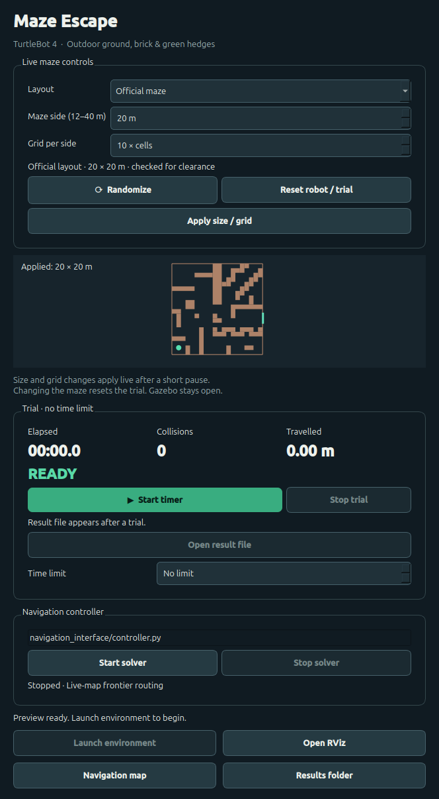

# TurtleBot 4 Maze Lab

**Generate a maze. Watch the robot build its map. Test your own navigation algorithm.**

`ail_tb4_maze` is a ROS 2 package for learning, experimenting with and evaluating sensor-based maze navigation. It includes a live setup GUI, randomized Gazebo worlds, a robot/map/path view in RViz, independent scoring, and an included frontier-exploration baseline to study or compare against.

**Featured video:** [Watch/download the larger maze ending clip](docs/media/complex-maze-ending.mp4) — 20 m × 20 m, 12 × 12 cells; escaped in 589.213 simulated seconds with zero recorded contacts. The clip uses 1× screen playback; the simulation target was 2×. [Capture details and scores](docs/media/README.md).

## What you can do

- Change maze size and grid density, or randomize the layout **without reopening Gazebo**.
- See the TurtleBot 4, live LiDAR, its discovered map, planned route and travelled path in RViz.
- Run unlimited experiments, or choose a simulated-time deadline for fair comparisons.
- Measure full-footprint escape, elapsed simulation time, travelled distance and wall-contact episodes.
- Study the included solver, replace its frontier heuristic, compare backends, or run your own Python controller.

The navigation algorithm receives **no generated map, maze dimensions or exit coordinates**. Its map comes from its own sensors. The operator's setup preview is a separate view of the full generated maze.

## Quick start

The tested platform is **Ubuntu 24.04, ROS 2 Jazzy and Gazebo Harmonic**, with the official TurtleBot 4 standard model. Start with ROS 2, Gazebo, `rosdep` and `colcon` installed and rosdep initialized. Package dependencies are declared in [`package.xml`](package.xml).

```bash
source /opt/ros/jazzy/setup.bash
mkdir -p ~/ai_legion_ws/src
git clone https://github.com/kishore-saravanan/ail_tb4_maze.git \
  ~/ai_legion_ws/src/ail_tb4_maze
cd ~/ai_legion_ws
rosdep install --from-paths src --ignore-src -r -y
colcon build --symlink-install --packages-select ail_tb4_maze
source install/setup.bash
ros2 launch ail_tb4_maze setup.launch.py
```

For an existing checkout, build and source its workspace rather than cloning again. See the official [ROS 2 Jazzy installation guide](https://docs.ros.org/en/jazzy/Installation/Ubuntu-Install-Debs.html) if ROS is not installed. Python requirements supplement the ROS/Ubuntu dependencies; do not install ROS or Gazebo bindings from pip.

## Run your first experiment

1. Choose a random maze, its physical size and grid density. **Randomize** and **Apply size / grid** update the live world and the setup preview.
2. Leave **Time limit = No limit**, or choose a positive number of simulated seconds. Zero means unlimited.
3. Press **Start timer**, then **Start solver**. The default solver starts SLAM and navigation together.
4. Watch RViz. Its map appears after SLAM starts: **light = known free space**, **dark = walls**, **grey-blue = unknown**, **orange = LiDAR**, **green = planned route**, **cyan = travelled path**. Use **Navigation map** to reopen the correct view.
5. Inspect the saved JSON score. **Stop trial** records a manual abort; **Reset robot / trial** prepares a fresh attempt and stops the solver. Restart the solver for each attempt.



The maze side can be set from 12–40 m. Grid density changes passage width as well as the number of junctions. Size/grid changes reset the attempt. Closing the setup GUI stops the environment it owns.

The time limit is captured at **Start timer** and stays fixed for that attempt. Unlimited mode retains the timer, distance and contact counts; success, manual abort or infrastructure failure can still end a run. Results store `time_limit_sim_seconds: 0` for unlimited duration.

## The included strategy

The default is **sensor-built frontier exploration with early goal retirement**:


**LiDAR → SLAM map → reachable frontier → Dijkstra route → sensor-checked motion → replan.**

The robot explores where known free space meets unknown space. Target choice considers travel cost, wall clearance, prior visits and a modest information-gain proxy. When a new scan has already revealed a target region, the planner retires that goal and chooses another frontier before driving all the way to the old tip. Motion uses live LiDAR checks and a **0.30 m/s** cap.

This is a classical planning baseline, not a trained neural network. Backtracking can still be necessary. It has no persistent corridor/junction graph or explicit outer-boundary-first heuristic. The referee detects escape; the robot does not yet declare escape itself. Read the [algorithm walkthrough, module map and limitations](docs/ALGORITHM.md).

## Try your own algorithm

Two useful starting points:

- **Change exploration decisions:** edit `choose_frontier()` in [`frontier_planner.py`](ail_tb4_maze/frontier_planner.py), retaining its contract. Reuse SLAM, route following, the GUI and scoring.
- **Replace the controller:** enter your Python script path in the GUI. [`examples/custom_controller.py`](examples/custom_controller.py) is a minimal sensor/command template that intentionally commands zero velocity until you implement its decision method.

The default GUI navigation domain is **62**; the infrastructure domain is **61**. Velocity commands use `geometry_msgs/msg/TwistStamped` on `/cmd_vel`. A replacement controller owns its mapping and collision-avoidance logic; the gateway still enforces command limits and trial gating. Read the [integration guide](docs/EXTENDING.md) before running a replacement controller. Do not run two controllers in the same domain.

## Reproducible trials and comparisons

From the repository, after sourcing ROS and the built workspace:

```bash
python3 scripts/run_experiment.py \
  --preset random --size 12 --cells 6 --seed 7 \
  --backend direct --rtf 1 --time-limit 300 --visible
```

The helper opens **visible Gazebo and RViz**, starts the timer and solver, records the scene and source hashes, then leaves the final scene paused for inspection. Close Gazebo or press Ctrl+C to clean up. It uses isolated domains **63/64** and its own Gazebo partition, so it does not modify the GUI's experiment.

- `--time-limit 0`: unlimited duration, the default.
- `--time-limit 300`: a five-minute simulated-time comparison budget.
- `--backend pledge` or `--backend nav2`: alternative included baselines.
- `--rtf 2`: request faster simulation while retaining the robot's speed cap.
- `--infra-domain` / `--nav-domain`: choose another unused domain pair for an independent run.
- `--wall-timeout SECONDS`: optional wall-clock watchdog; disabled by default.

**Four recorded development samples** used the same solver/configuration, requested RTF 2 and a 300 simulated-second limit:

| Maze side | Grid | Seed | Escaped | Simulated time | Travel | Contacts |
| --- | --- | --- | --- | ---: | ---: | ---: |
| 12 m | 6×6 | 198382678 | Yes | 91.9 s | 20.9 m | 0 |
| 12 m | 8×8 | 109460176 | Yes | 75.7 s | 16.5 m | 0 |
| 16 m | 8×8 | 1773841193 | Yes | 199.6 s | 49.3 m | 0 |
| 16 m | 10×10 | 1631833898 | Yes | 152.4 s | 34.4 m | 0 |

These are one seed per combination, not a general success-rate estimate or a density ranking. The generator currently keeps the exit on the east boundary; the solver does not receive that information. [Validation summary and tested scope](docs/VALIDATION.md).

## Code and experiment data

```text
ail_tb4_maze/          Mapping, planning, motion, GUI, gateway and referee
launch/               Setup, navigation and visualization launches
config/               SLAM, navigation, RViz and challenge settings
examples/             Minimal replacement-controller template
navigation_interface/ Default entry point and comparison baseline
assets/, worlds/      Local textures, geometry and upstream world licenses
scripts/, test/       Experiment runners, validation helpers and regressions
docs/                 Algorithm guide, integration guide, media and results
.runtime/             Local scenes, logs and raw experiment evidence (Git-ignored)
.tools/               Local dependency fallbacks (Git-ignored)
```

Results live under `.runtime/results/experiment_*/` in a source checkout. Installed-only packages use `$XDG_STATE_HOME/ail_tb4_maze`, normally `~/.local/state/ail_tb4_maze`. The setup launch supports a `runtime_dir` override. Normal ROS `build/`, `install/` and `log/` directories remain at workspace level.

The independent referee uses Gazebo pose/contact data to score full-footprint exit crossing, distance and contact episodes. Contacts are counted; a successful crossing does not automatically require zero contacts. ROS-domain separation is a logical interface rule, not an OS security sandbox.

## Development and checks

```bash
colcon test --packages-select ail_tb4_maze
colcon test-result --verbose
```

Python follows the project Ruff formatter and PEP 8-oriented lint rules: four-space indentation, separated imports, readable blocks and an 88-character line limit. To use the pinned development tool in an isolated environment:

```bash
python3 -m venv .venv
.venv/bin/pip install -r requirements-dev.txt
.venv/bin/ruff check .
.venv/bin/ruff format .
python3 scripts/check_return_spacing.py --fix
python3 scripts/check_return_spacing.py
```

Keep a fixed seed, grid, speed cap and time budget when comparing algorithms. Report failures as well as successes, distinguish simulated time from wall time, and retain the raw result alongside any edited video. See [validation notes](docs/VALIDATION.md) for the tested scope and known limitations.

## License and attribution

Project code: [Apache-2.0](LICENSE). Robot, ROS and Gazebo components retain their upstream licenses. Texture sources/licenses are in [TEXTURE_ATTRIBUTION.md](docs/TEXTURE_ATTRIBUTION.md); world provenance is in [MAZE_SELECTION.md](docs/MAZE_SELECTION.md) and [worlds/LICENSE.upstream](worlds/LICENSE.upstream).

Python style also requires a blank line before every `return` statement. After Ruff formatting, run `python3 scripts/check_return_spacing.py --fix`; check with `python3 scripts/check_return_spacing.py`.
