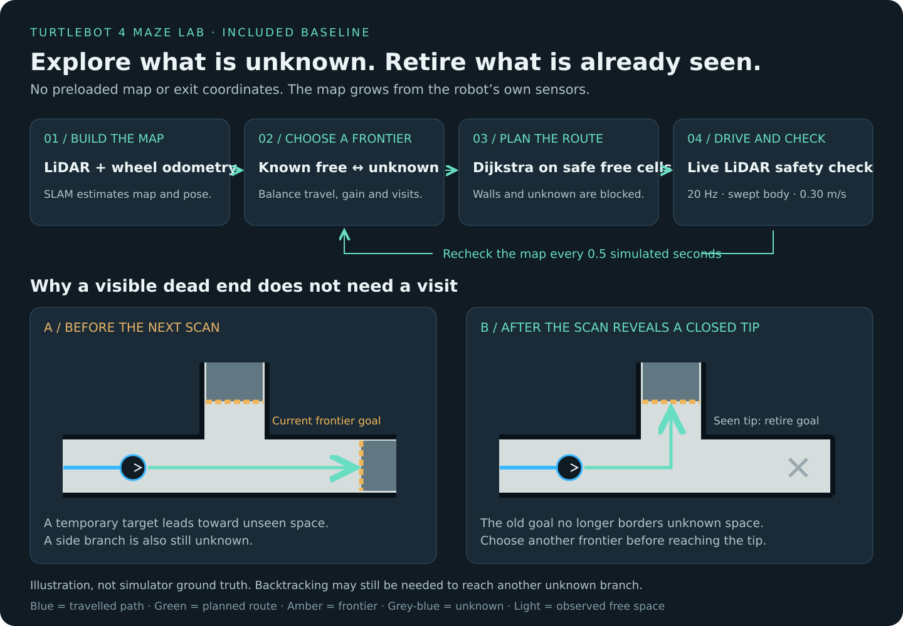
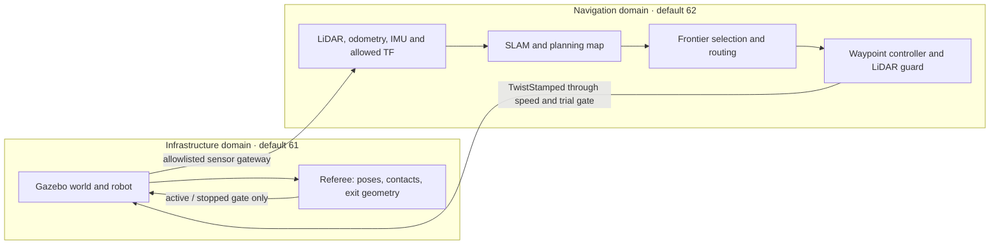

# How the included solver works

The default is **sensor-built frontier exploration with early goal retirement**.
It is a classical mapping and planning baseline, not a trained neural network.
It has no preloaded maze, cell spacing, maze dimensions or exit coordinates.

## The loop

1. **Observe and localize.** SLAM Toolbox combines LiDAR scans with wheel odometry and sensor transforms. It publishes a 5 cm occupancy grid and a map-relative robot pose. Current LiDAR rays are also fused into the planning map to account for recently seen free space and walls.
2. **Find reachable frontiers.** A frontier is observed free space adjoining unknown space. The planner inflates walls for clearance, rejects disconnected candidates and groups neighboring frontier cells.
3. **Choose where to explore.** Candidate costs combine reachable path length, wall clearance, a penalty for revisiting nearby areas, a penalty for tiny isolated scan holes, and a modest reward for larger frontiers. This is a heuristic; information gain is approximated by frontier size rather than predicted with a sensor model.
4. **Find a safe route.** A sparse grid graph and Dijkstra search produce a route through known free cells. Diagonal corner-cutting is forbidden. A line-of-sight simplifier removes unnecessary waypoints while retaining clearance.
5. **Drive with current sensor checks.** The controller runs at 20 Hz, turns toward waypoints and limits forward speed to 0.30 m/s. Each proposed motion is checked against real LiDAR using a swept circular footprint. Missing or stale sensor data stops motion. Bounded reverse recovery is available when an approach is blocked.
6. **Reconsider as the map grows.** At 2 Hz, the planner checks the route and the old goal. If its connected local free-space neighborhood no longer touches unknown space, that goal has already served its purpose. The robot chooses a new frontier without having to reach the old goal physically.

The early-retirement check is the important difference from simply driving to every previously selected target. A scan may reveal a closed corridor while the robot is still several metres away. The planner can then redirect toward another passage. Unknown cells behind a separating wall cannot keep the old goal active.

## Where to read and modify the code

| File | Responsibility |
| --- | --- |
| [`direct_navigation.py`](../ail_tb4_maze/direct_navigation.py) | Exploration lifecycle, route checks, replanning, command publication |
| [`frontier_planner.py`](../ail_tb4_maze/frontier_planner.py) | Frontier scoring, connectivity, Dijkstra, observed-goal retirement |
| [`path_follower.py`](../ail_tb4_maze/path_follower.py) | Waypoint tracking, line-of-sight simplification, live swept-body guard |
| [`frontier_node.py`](../ail_tb4_maze/frontier_node.py) | Shared sensor/map callbacks and telemetry; also contains the Nav2 comparison node |
| [`sensor_map.py`](../ail_tb4_maze/sensor_map.py) | Current LiDAR ray fusion into the sensor-built map |
| [`slam.yaml`](../config/slam.yaml) | SLAM Toolbox settings |
| [`navigation_manager.py`](../ail_tb4_maze/navigation_manager.py) | Launches the selected navigation backend |
| [`controller.py`](../navigation_interface/controller.py) | Small default entry point used by the GUI |

For a frontier-selection experiment, start with `choose_frontier()` in `frontier_planner.py`. For a different driving policy, start with `PathFollower.step()`. Keep their input/output contracts and run the regression tests after changing behavior.

## Sensors and scoring are separate

The referee knows the exit so it can score a full-footprint crossing. The solver does not receive those coordinates or referee topics. It explores through an opening; the referee detects success and disables motion. **The solver does not yet declare “I have escaped” itself.**

ROS-domain separation is a logical challenge rule, not an OS sandbox against a same-user process deliberately reading world files or connecting to Gazebo transport.

## What this baseline does not promise

- It does not guarantee the fastest solution or completion of every maze. Required backtracking and imperfect sensing can increase travel.
- It uses occupancy-grid connectivity, not a persistent junction-to-junction corridor graph. Two routes through one corridor can still occur when a return is necessary.
- It does not currently implement an explicit “search the outer boundary first” heuristic. The physical maze boundary is not provided to the planner.
- The generator currently varies walls and exit row while keeping the exit on the east boundary. The planner does not read that information. Tests across other exit sides would be needed for broader claims.
- SLAM loop closure is disabled in the supplied configuration because repetitive corridors caused false corrections during development. Drift remains a limitation.
- The nominal swept-body radius is conservative, not a full dynamic model of every part of the robot. Gazebo results do not establish hardware safety.

Pledge with closed-corridor memory (`--backend pledge`) and a Nav2 frontier stack (`--backend nav2`) remain comparison backends. The default `direct` backend is the one described above.
